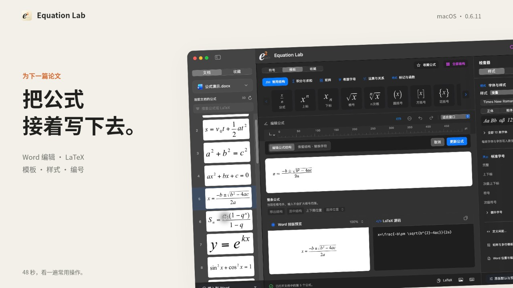
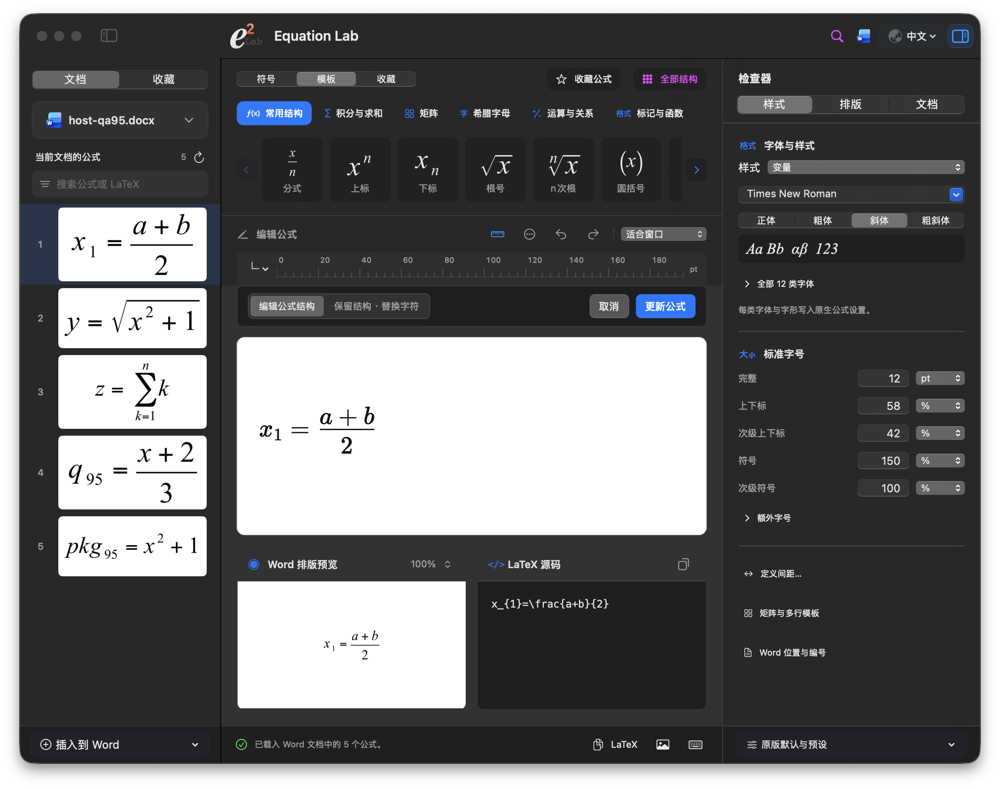
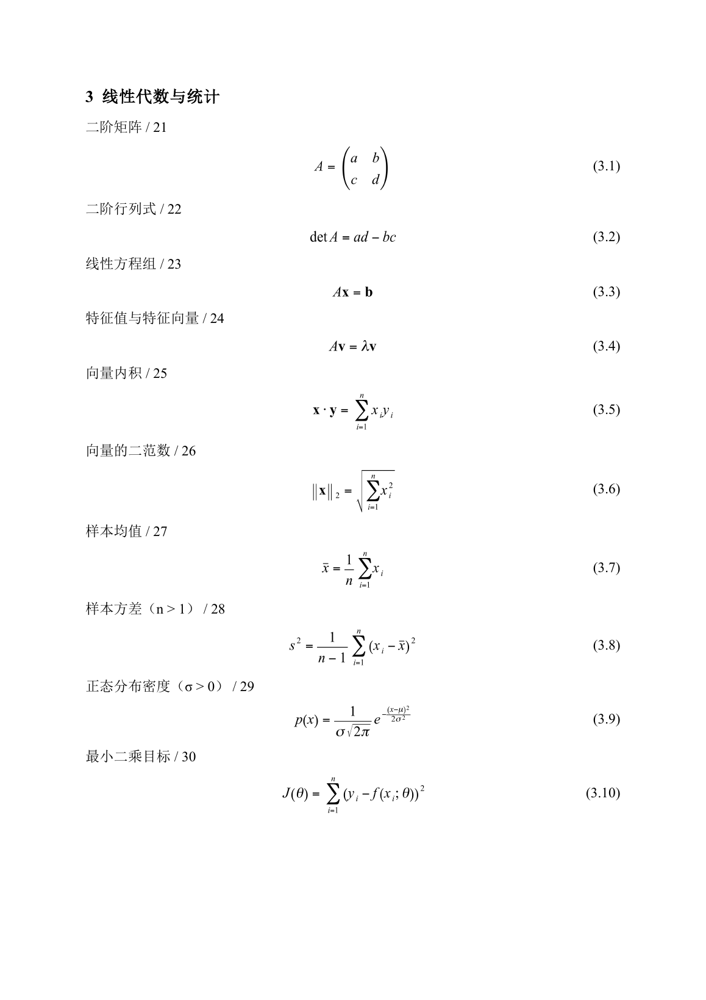

<p align="center"></p>
<h1 align="center">Equation Lab</h1>

I started this project to keep editing MathType equations in Word on a Mac. It also works on its own, with templates or LaTeX.

[中文](README.md)

**[Download 0.6.13 (build101)](https://github.com/Ne1ther/EquationLab/releases/download/v0.6.13/Equation-Lab-0.6.13.pkg)** · [Releases](https://github.com/Ne1ther/EquationLab/releases) · [Install](docs/install.md)

For Apple Silicon Macs running macOS 14 or later. The installer includes the app, Word plugin, and runtime. No separate Node, Python, or MathType installation is needed. Word features require desktop Word for Mac.

Save your documents, quit Word and Equation Lab, then open the installer. Open the app afterward and complete any Word plugin setup prompts. Reopen Word to use the **Equation Lab** ribbon. Double-click an equation to edit it in a separate window, then save it back in place.

[](https://github.com/Ne1ther/EquationLab/releases/download/v0.6.11/EquationLab-0.6.11-demo-zh.mp4)

[Watch the 48-second demo](https://github.com/Ne1ther/EquationLab/releases/download/v0.6.11/EquationLab-0.6.11-demo-zh.mp4): real app and Word screens showing editing, LaTeX, templates, font size, numbering, and document switching. Silent, with Chinese captions.

## What it does

- Choose a Word document, then browse, search, insert, and edit its MathType equations.
- Write multiline equations, cases, and matrices using visual templates or LaTeX, then fine-tune fonts, sizes, and spacing.
- Set equation numbers, chapters, and sections, and insert cross-references from a searchable list.
- Check document numbering and references, preview batch style and numbering changes, and save a Word copy.
- Store a document style preset for future equations, export PDF, SVG, or PNG, and copy LaTeX.

Select a document at the top of the sidebar, then click Insert into Word to choose inline, centered, or left/right numbered placement. If you are editing an existing equation, the new one is inserted after its paragraph. For a standalone draft, place the cursor in the selected Word document without selecting text or an object. The draft's content and formatting carry over. After you click Finish and insert, the app shows the save result returned by Word.

The sidebar menu lists open Word documents and distinguishes files that share the same name. If you switch documents with unsaved changes, the app asks how you want to handle the draft. For large documents, it opens the selected equation first and loads the rest of the list in batches. Thumbnails appear and update as you browse, and the app scrolls to the equation you open.

Under **Document → Word layout**, adjust the number format, chapter, and section, then choose Update equation to apply them to the current equation and use the format for later numbered insertions. To organize existing numbers, open **Document checks and batch tools**, choose the current equation, existing numbered equations, or future equations, then preview and save a copy. Use the Word ribbon to adjust legacy MathType numbering; Update Numbers recalculates equation sequences and cross-references.

The same panel lets you search numbers and references, find broken references, and apply the current equation’s fonts, sizes, and spacing to a document copy. The copy tools list the results before saving, then offer Open in Word and Show in Finder. Centered and numbered equations use the current page width and equal-column layout; inline insertion preserves the surrounding paragraph formatting. [Read the document tools guide](docs/document-tools.md)

During Chinese input, the Word plugin defers macro calls until composition finishes. The formula editors also wait before updating previews. When typing formulas by hand, the controls below the canvas show the active structure. You can place sum and integral limits above and below the symbol or to its right.

The app checks for updates once a day by default and shows a toolbar button when a newer version is available. You can also open **Equation Lab → Check for updates…** to check manually or enable automatic downloads. If you run into connection trouble, open the **Office plugin** panel to check the status or copy connection diagnostics.



## Try a document

[Download the 30-equation Word demo](docs/examples/equation-lab-30-formulas.docx) · [View the PDF](docs/examples/equation-lab-30-formulas.pdf)

Three sections, ten equations each, with 12 pt SimSun Chinese text. Includes radicals, sums, integrals, matrices, numbering, and cross-references. Open it and try editing.



[More screenshots](docs/preview/README.md) · [Equations, fonts, and spacing](docs/features.md)

## Build it yourself

Install Node.js 24 and Swift 6.2 / Xcode command-line tools.

```sh
npm ci
swift build
./scripts/build_and_run.sh
```

[Development](docs/development.md) · [Directories and files](docs/file-guide.md) · [Packaging](packaging/README.md)

If something goes wrong, [open an issue](https://github.com/Ne1ther/EquationLab/issues) with the version, equation, or steps to reproduce it.

Source is under [MIT](LICENSE). See [third-party notices](THIRD_PARTY_NOTICES.md) for bundled resources.
