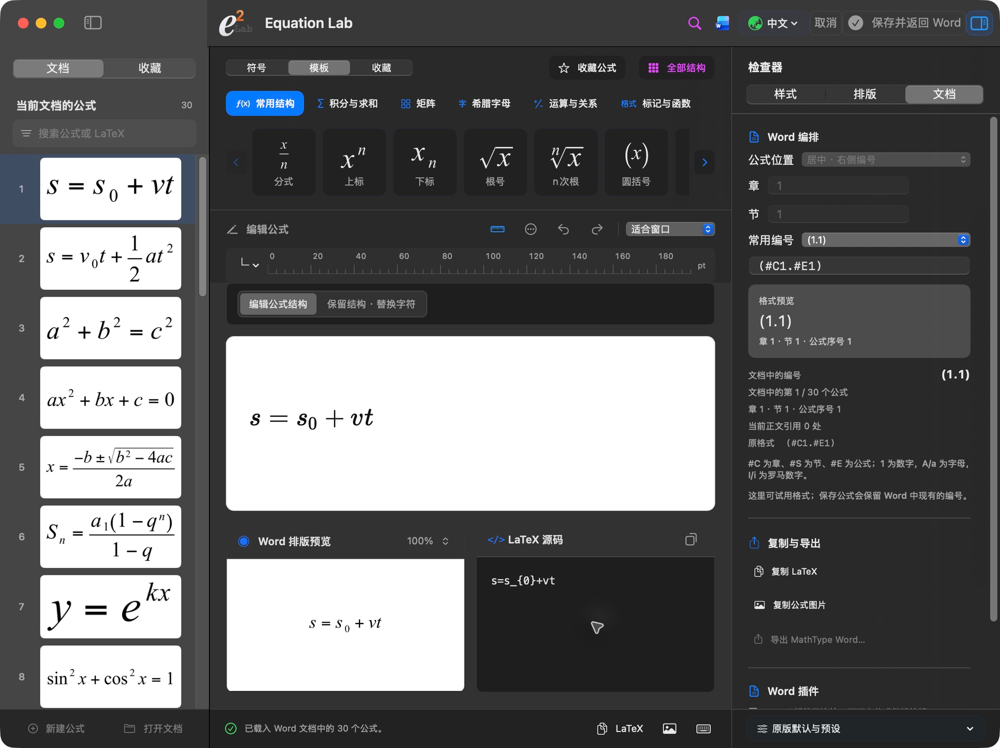

<p align="center"></p>
<h1 align="center">Equation Lab</h1>

I started this project to keep editing MathType equations in Word on a Mac. The editor also works on its own, with templates or LaTeX input.

[中文](README.md)

**[Download the 0.6.0 installer](https://github.com/Ne1ther/EquationLab/releases/download/v0.6.0/Equation-Lab-0.6.0.pkg)** · [Releases](https://github.com/Ne1ther/EquationLab/releases) · [Install](docs/install.md)

For Apple Silicon Macs running macOS 14 or later. The installer includes the app, Word plugin, and runtime components. You do not need to install Node, Python, or MathType. Word integration requires desktop Word for Mac.

Save your documents and quit Word and Equation Lab before opening the installer. Reopen Word and use the **Equation Lab** ribbon. Double-click an equation to edit it, then save it back to the same place.

## Everyday use

- Open a Word document and browse or search its MathType equations on the left.
- Edit with templates or LaTeX, and adjust fonts, sizes, symbols, and spacing.
- Choose inline, centered, or numbered layout. Use a numbering preset or enter your own format and see a live preview.
- Use Word numbering and cross-references; export PDF, SVG, or PNG, or copy LaTeX.
- Choose **Equation Lab → Check for updates…**, with optional daily checks and automatic downloads.



## Try a document

[Download the 30-equation Word demo](docs/examples/equation-lab-30-formulas.docx) · [View the PDF](docs/examples/equation-lab-30-formulas.pdf)

Three sections with ten equations each, using 12 pt SimSun for Chinese text. Includes radicals, sums, integrals, matrices, numbering, and cross-references. Open it and double-click an equation to try editing.


[More screenshots](docs/preview/README.md) · [Fonts and spacing](docs/features.md)

## Project layout

| Directory | Contents |
| --- | --- |
| [macos/](macos/) | Native Mac windows, sidebar, inspectors, and menus |
| [desktop/](desktop/) | Equation canvas and frontend interaction |
| [src/](src/) | Equation data, rendering, Word documents, and local communication |
| [native-word-probe/](native-word-probe/) | Word ribbon, document events, and native equation component |
| [font-metrics/](font-metrics/) | Font outlines and image/PDF rendering helper |
| [updater/](updater/) | Update downloads and verification |
| [assets/](assets/) · [design/](design/) | Fonts, resource licenses, icons, and template previews |
| [packaging/](packaging/) · [scripts/](scripts/) | Build, installer, and release scripts |
| [tests/](tests/) | Equation, document, interaction, and installer tests |
| [docs/](docs/) | Guides, actual screenshots, and public examples |

[Key files explained](docs/file-guide.md). Installers are in [Releases](https://github.com/Ne1ther/EquationLab/releases), separate from source.

## Build it yourself

Install Node.js 24 and Swift 6.2 / Xcode command-line tools.

```sh
npm ci
swift build
./scripts/build_and_run.sh
```

[Development](docs/development.md) · [Packaging](packaging/README.md)

If something goes wrong, please [open an issue](https://github.com/Ne1ther/EquationLab/issues) with the version, equation, and steps to reproduce it.

Source is under [MIT](LICENSE). See [third-party notices](THIRD_PARTY_NOTICES.md) for bundled resources.
