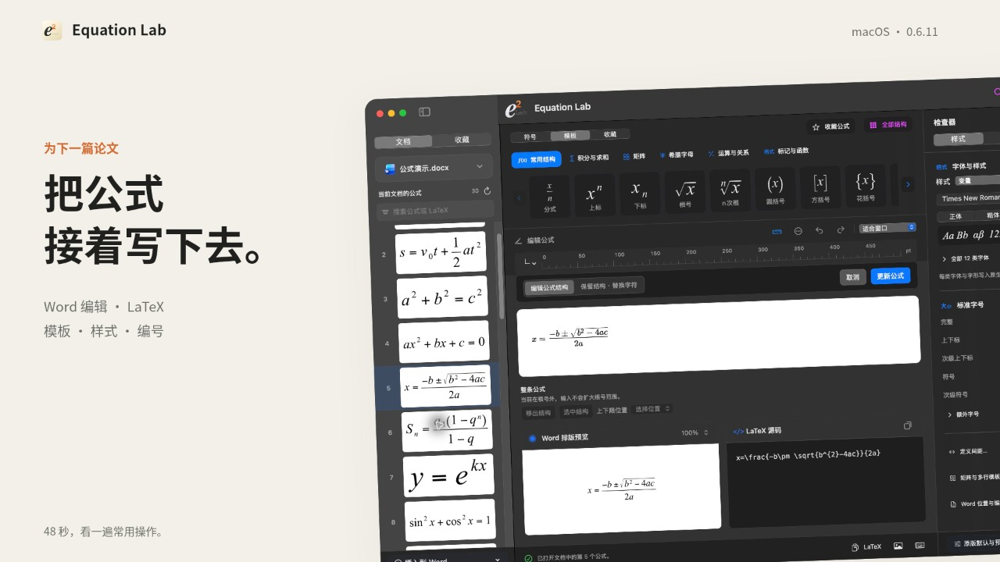
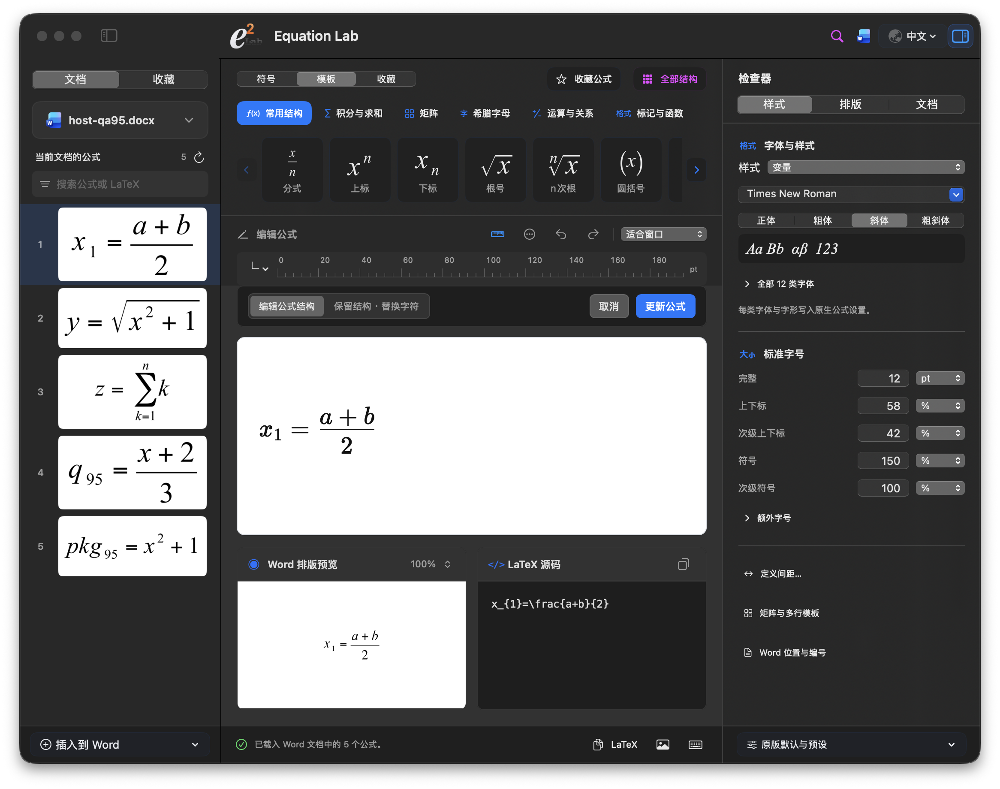

<p align="center"></p>
<h1 align="center">Equation Lab</h1>

I started this project to keep editing MathType equations in Word on a Mac. It also works on its own, with templates or LaTeX.

[中文](README.md)

**[Download 0.6.12 (build100)](https://github.com/Ne1ther/EquationLab/releases/download/v0.6.12/Equation-Lab-0.6.12.pkg)** · [Releases](https://github.com/Ne1ther/EquationLab/releases) · [Install](docs/install.md)

For Apple Silicon Macs running macOS 14 or later. The installer includes the app, Word plugin, and runtime. No separate Node, Python, or MathType installation is needed. Word features require desktop Word for Mac.

Save your documents, quit Word and Equation Lab, then open the installer. Reopen Word to find the **Equation Lab** ribbon. Double-click an equation to edit it in a separate window, then save it back in place.

[](https://github.com/Ne1ther/EquationLab/releases/download/v0.6.11/EquationLab-0.6.11-demo-zh.mp4)

[Watch the 48-second demo](https://github.com/Ne1ther/EquationLab/releases/download/v0.6.11/EquationLab-0.6.11-demo-zh.mp4): real app and Word screens showing editing, LaTeX, templates, font size, numbering, and document switching. Silent, with Chinese captions.

## What it does

- Choose a Word document, then browse, search, insert, and edit its MathType equations.
- Enter templates or LaTeX, including multiple lines, cases, and matrices; adjust fonts, sizes, and spacing.
- Set equation numbers, chapters, and sections, and insert cross-references from a searchable list.
- Check document numbering and references, preview batch style and numbering changes, and save a Word copy.
- Store a document style preset for future equations, export PDF, SVG, or PNG, and copy LaTeX.

Choose a document at the top of the sidebar, then use Insert into Word for inline, centered, or left/right numbered placement. While editing an existing equation, the new one goes after its paragraph. A standalone draft uses the selected document’s empty Word cursor and carries its content and formatting into the insertion session. After you choose Finish and insert, the app shows the save result returned by Word.

The sidebar menu lists open Word documents and distinguishes files with the same name. Switching prompts you to handle unsaved drafts. Long documents open the current equation first and load the rest in batches. Thumbnails appear and update individually as you browse, and the current equation scrolls into view.

Under **Document → Word layout**, adjust the number format, chapter, and section, then choose Update equation to apply them to the current equation and use the format for later numbered insertions. To organize existing numbers, open **Document checks and batch tools**, choose the current equation, existing numbered equations, or future equations, then preview and save a copy. Use the Word ribbon to adjust legacy MathType numbering; Update Numbers recalculates equation sequences and cross-references.

The same panel lets you search numbers and references, find broken references, and apply the current equation’s fonts, sizes, and spacing to a document copy. The copy tools list the results before saving. Open the new file in Word and update its numbering and references to continue editing. [Read the document tools guide](docs/document-tools.md)

Chinese input in Word and the formula editors waits for composition to finish before synchronization. Manual editing provides structure cues and controls for sum-limit placement.

The app checks daily by default and shows an update button when a newer version is available. Use **Equation Lab → Check for updates…** to check manually or set up automatic downloads. For connection issues, check the status and copy connection diagnostics from the **Office plugin** panel.



## Try a document

[Download the 30-equation Word demo](docs/examples/equation-lab-30-formulas.docx) · [View the PDF](docs/examples/equation-lab-30-formulas.pdf)

Three sections, ten equations each, with 12 pt SimSun Chinese text. Includes radicals, sums, integrals, matrices, numbering, and cross-references. Open it and try editing.


[More screenshots](docs/preview/README.md) · [Equations, fonts, and spacing](docs/features.md)

## Build it yourself

Install Node.js 24 and Swift 6.2 / Xcode command-line tools.

```sh
npm ci
swift build
./scripts/build_and_run.sh
```

[Development](docs/development.md) · [Directories and files](docs/file-guide.md) · [Packaging](packaging/README.md)

If something goes wrong, [open an issue](https://github.com/Ne1ther/EquationLab/issues) with the version, equation, or steps to reproduce it.

Source is under [MIT](LICENSE). See [third-party notices](THIRD_PARTY_NOTICES.md) for bundled resources.
