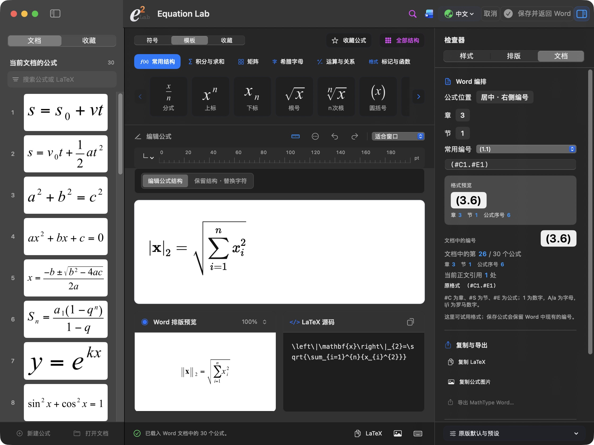
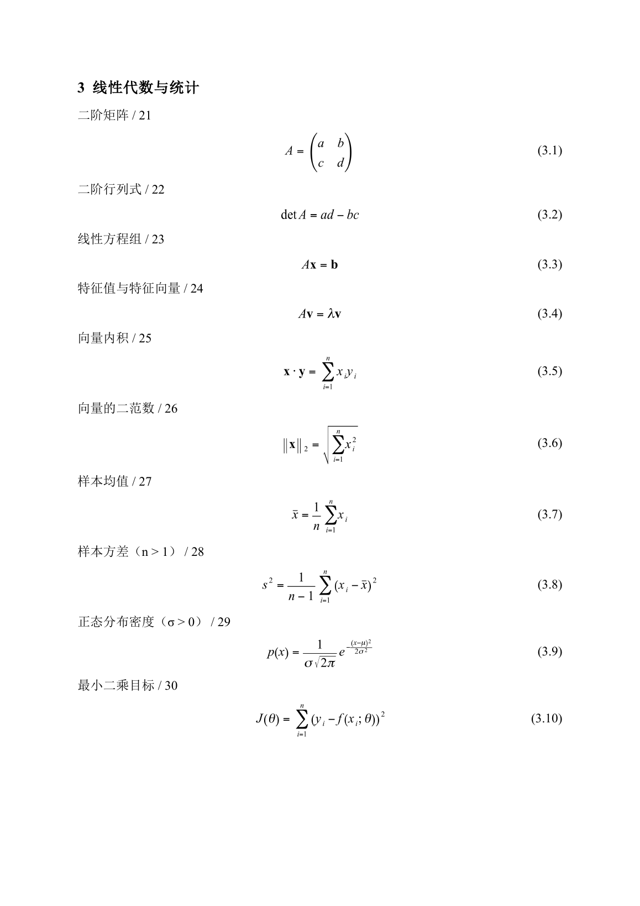

<p align="center"></p>
<h1 align="center">Equation Lab</h1>

I started this project to keep editing MathType equations in Word on a Mac. It also works on its own, with templates or LaTeX.

[中文](README.md)

**[Download the 0.6.1 installer](https://github.com/Ne1ther/EquationLab/releases/download/v0.6.1/Equation-Lab-0.6.1.pkg)** · [Releases](https://github.com/Ne1ther/EquationLab/releases) · [Install](docs/install.md)

For Apple Silicon Macs running macOS 14 or later. The installer includes the app, Word plugin, and runtime. No separate Node, Python, or MathType installation is needed. Word features require desktop Word for Mac.

Save your documents, quit Word and Equation Lab, then open the installer. Reopen Word to find the **Equation Lab** ribbon. Double-click an equation to edit it in a separate window, then save it back in place.

## What it does

- Browse and search document equations, edit them, and save back to Word.
- Enter templates or LaTeX; adjust fonts, sizes, and spacing.
- Use equation numbering, cross-references, format presets, and custom previews.
- Export PDF, SVG, or PNG, and copy LaTeX.

Updates are under **Equation Lab → Check for updates…**, with optional daily checks and automatic downloads.



## Try a document

[Download the 30-equation Word demo](docs/examples/equation-lab-30-formulas.docx) · [View the PDF](docs/examples/equation-lab-30-formulas.pdf)

Three sections, ten equations each, with 12 pt SimSun Chinese text. Includes radicals, sums, integrals, matrices, numbering, and cross-references. Open it and try editing.



[More screenshots](docs/preview/README.md) · [Fonts and spacing](docs/features.md)

## Build it yourself

Install Node.js 24 and Swift 6.2 / Xcode command-line tools.

```sh
npm ci
swift build
./scripts/build_and_run.sh
```

[Development](docs/development.md) · [Directories and files](docs/file-guide.md) · [Packaging](packaging/README.md)

If something goes wrong, [open an issue](https://github.com/Ne1ther/EquationLab/issues) with the version, equation, or steps to reproduce it.

Source is under [MIT](LICENSE). See [third-party notices](THIRD_PARTY_NOTICES.md) for bundled resources.
