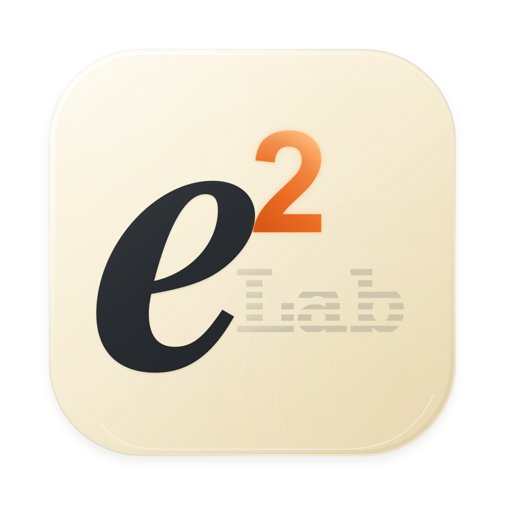
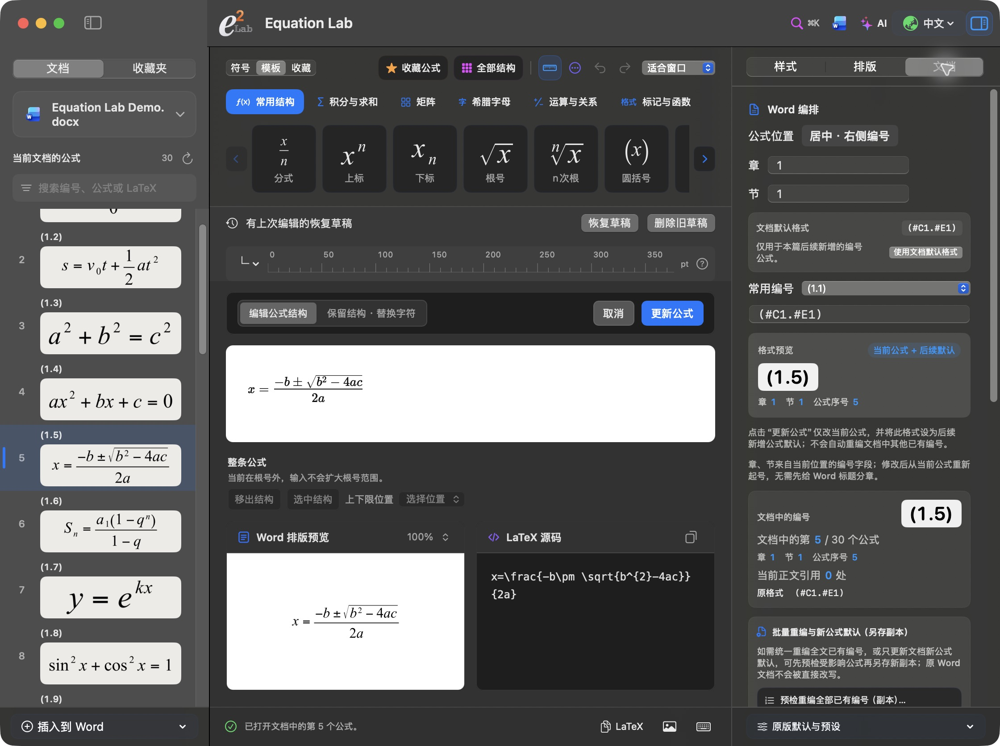

<p align="center"></p>
<h1 align="center">Equation Lab</h1>
<p align="center"><a href="README.md">中文</a></p>

I built Equation Lab so I could keep editing existing MathType equations in Word on an Apple Silicon Mac. Double-click a Word equation to open it in the editor and save it back to the same place. You can also open the app on its own to write equations with templates or LaTeX.

**[Download 0.7.10 Installer (build 114)](https://github.com/Ne1ther/EquationLab/releases/download/v0.7.10/Equation-Lab-0.7.10.pkg)** · [Release Notes](docs/releases.md) · [Install & Troubleshooting](docs/install.md) · [All Releases](https://github.com/Ne1ther/EquationLab/releases)

> Requires an **Apple Silicon Mac with macOS 14 or later**. Word integration uses **desktop Word for Mac**. The installer includes the app, Word plugin, fonts, and runtime. MathType is optional.



**[Watch the 29-second 0.7.4 walkthrough](https://github.com/Ne1ther/EquationLab/releases/download/v0.7.4/EquationLab-0.7.4-demo-zh.mp4)** · [More screenshots](docs/preview/README.md)

## Four ways you will use it

### 1. In-place Word editing and standalone drafting

- Use the **Equation Lab** ribbon in desktop Word to insert inline, centered, or left/right-numbered equations, or **double-click an existing MathType equation** to open the editor. Choose **Update Equation** to save edits or **Finish and Insert** for a new equation.
- The sidebar lists open Word documents (including files with the same name) and lets you search by displayed number and LaTeX. Where progressive loading is available, you can select equations while the rest of the document loads. Mix visual templates with LaTeX for multiline formulas, cases, and matrices, adjust fonts, sizes, and spacing, or work in a standalone draft and export PDF, SVG, or PNG.
- Opening a `.docx` copy shows the equation list first. Thumbnails load as you browse, and the editor prompts you before replacing an unsaved draft.

[Editor guide](docs/features.md) · [Draft recovery](docs/draft-recovery.md)

### 2. Equation numbering, chapters, and cross-references

- Set the number format, chapter, and section under **Document → Word layout** in the inspector. In the Word ribbon, select a standalone equation to add or move **Left Number / Right Number**, or use **Insert Reference** to search by equation number or nearby text.
- After inserting, deleting, or moving equations, click **Update Numbers** in Word to recalculate sequences and cross-references across both Equation Lab and legacy MathType numbering. Updated formats also become the default for future numbered insertions.
- If the document still uses legacy Equation Lab numbering, the app asks for confirmation before the first format save converts the document’s numbering fields.

### 3. Batch checks and document-copy tools

- Open **Document → Document checks and batch tools** in the right inspector.
- Audit equation numbers, broken references, locked fields, and mixed formats; apply the current equation’s fonts, sizes, spacing, or numbering format across a chosen scope, or store a document style preset for future equations.
- Review the changes for each equation, then **save a new Word copy**. To recalculate fields, open the copy in Word and click **Update Numbers**. [Document tools guide](docs/document-tools.md)

### 4. Local AI Skill for Word equations

- Choose **AI → Install or Export Skill…** in the app toolbar and click **Install Shared Skill** to install to `~/.agents/skills/equation-lab`.
  - **Codex**. Reads the shared folder by default. Use `$equation-lab` in a session.
  - **DeepSeek Harness (DSH)**. Reads the shared folder with the default profile. Invoke with `/equation-lab` or by name.
  - **Claude Code**. Click the **Claude Code** card to link the shared Skill. Use `/equation-lab` in a new session.
  - **Antigravity**. Click the **Antigravity** card to link the shared Skill. Open a new session or run `/skills reload` in `agy`.
  - **Other clients**. Open **Other clients** to copy setup instructions for your agent or export a standalone Skill folder.
- Use it with **saved `.docx` files** to list equations, check numbers and references, generate editable equations, or batch-edit a new copy. Use the Word plugin to insert at the current cursor position or work with an unsaved document.

Try this prompt

> `Use equation-lab to check the equations, numbers, and cross-references in /path/to/paper.docx, set all equations to 12 pt, and save the result as a new copy.`

See the [Skill guide](skills/equation-lab/SKILL.md) and [client setup reference](skills/equation-lab/references/installing.md).

## Try a sample document

**[Download the 30-equation Word sample (DOCX)](docs/examples/equation-lab-30-formulas.docx)** · [View PDF](docs/examples/equation-lab-30-formulas.pdf)

The sample includes radicals, sums, integrals, matrices, numbers, and cross-references. Open it in Word to try double-click editing, numbering, and batch tools.

## Install, compatibility, and troubleshooting

1. Save your open documents and quit both Word and Equation Lab.
2. Run `Equation-Lab-0.7.10.pkg` (download from GitHub Releases and verify against the release `SHA256SUMS.txt`).
3. Open Equation Lab first, grant Office folder access if prompted, and run **Install / Update Word plugin**.
4. Reopen Word to use the **Equation Lab** ribbon at the top.

- **Not notarized**. The bundled app uses ad-hoc signing and is not notarized by Apple, so macOS may report an unverified developer. See [Install & Troubleshooting](docs/install.md).
- **Compatibility limits**. Covers common existing MathType equations and legacy numbering and references. See the [features guide](docs/features.md) for supported formats. The batch preview lists skipped items and explains why.
- **Troubleshooting & updates**. If the ribbon is missing or shows `Word native component is not connected.`, quit Word completely and use the app’s **Office plugin** panel to repair the plugin, test the connection, or copy connection diagnostics. See [Install & Troubleshooting](docs/install.md) and [App updates](docs/updates.md), or [open an issue](https://github.com/Ne1ther/EquationLab/issues) with your app/macOS/Word versions, repro steps, or diagnostics.

## Build from source & license

Requires Node.js 24 and Swift 6.2 / Xcode command-line tools.

```sh
npm ci
swift build
./scripts/build_and_run.sh
```

[Development guide](docs/development.md) · [Directory & file guide](docs/file-guide.md) · [Packaging](packaging/README.md)

Source code is licensed under [MIT](LICENSE). Bundled third-party resources are listed in [THIRD_PARTY_NOTICES.md](THIRD_PARTY_NOTICES.md).
