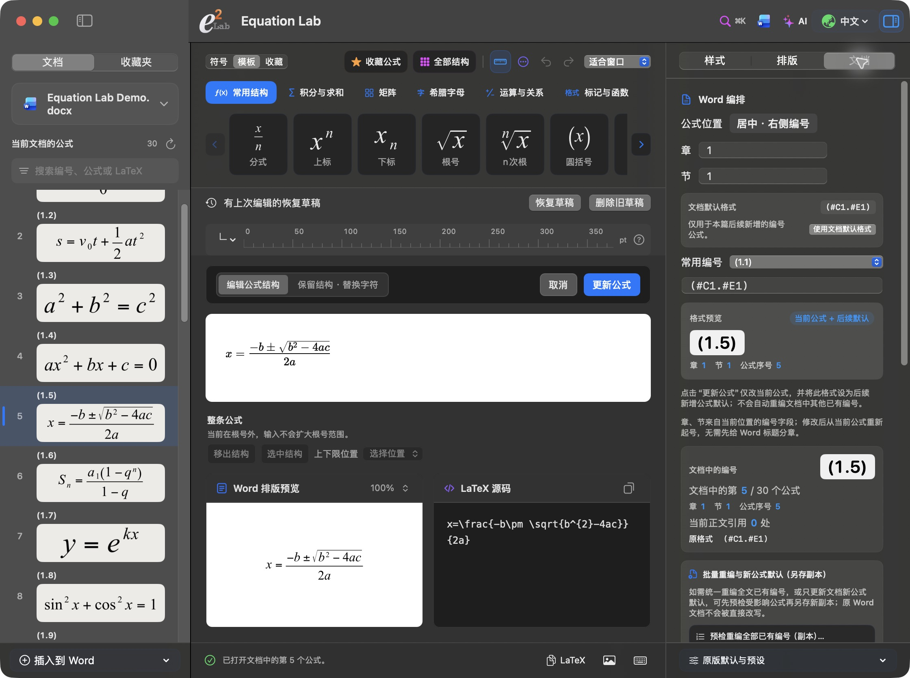

<p align="center"></p>
<h1 align="center">Equation Lab</h1>
<p align="center"><a href="README.en.md">English</a></p>

做这个项目，是想在 M 系列 Mac 的 Word 里把原来的 MathType 公式接着写下去。在 Word 里双击公式打开编辑器，改完写回原位置。也可以单独打开 App，用模板或 LaTeX 写公式。

**[下载 0.7.11 安装包（build 115）](https://github.com/Ne1ther/EquationLab/releases/download/v0.7.11/Equation-Lab-0.7.11.pkg)** · [更新记录](docs/releases.md) · [安装与排查](docs/install.md) · [全部 Releases](https://github.com/Ne1ther/EquationLab/releases)

> 适用 **Apple Silicon（M 系列）Mac，macOS 14 及以上**。Word 联动需要**桌面版 Word for Mac**。安装包已包含 App、Word 插件、字体和运行时，无需另装 MathType。



**[看 0.7.4 的 29 秒演示](https://github.com/Ne1ther/EquationLab/releases/download/v0.7.4/EquationLab-0.7.4-demo-zh.mp4)** · [更多实际截图](docs/preview/README.md)

## 四个主要用法

### 1. Word 原地编辑与独立写公式

- 打开桌面版 Word，用顶部的 **Equation Lab** 功能区插入行内、居中或左右编号公式，或直接**双击已有 MathType 公式**进入编辑器。编辑已有公式后点 **更新公式**，新公式点 **完成并插入**。
- 左侧列出当前打开的多份 Word 文档（同名文件也能区分），也可以按编号和 LaTeX 搜索。支持渐进加载的长文档会先显示可点选目录，再补齐内容。用模板或 LaTeX 写多行、分段和矩阵，调整字体、字号和间距，或导出 PDF、SVG、PNG。
- 打开 `.docx` 副本时，先显示公式目录，缩略图随浏览加载。新建或切换公式前会提示处理未保存的草稿。

[编辑与样式说明](docs/features.md) · [草稿恢复说明](docs/draft-recovery.md)

### 2. 编号、章节与交叉引用

- 在编辑器右侧 **文档 → Word 编排** 设置编号格式与章、节。在 Word 功能区选单条正文公式可补加或切换 **左侧编号 / 右侧编号**，正文里点 **插入引用** 可搜索编号或附近文字来插入交叉引用。
- 增删或移动公式后，点 Word 功能区的 **更新编号** 重算序号和交叉引用，同时兼容 Equation Lab 和旧版 MathType 编号。新设的编号格式会作为后续新增编号的默认值。
- 如果文档仍使用旧 Equation Lab 编号，首次保存编号格式时会提示确认全文编号字段的转换。

### 3. 文档副本批量工具（先预检，再另存副本）

- 在编辑器右侧打开 **文档 → 文档检查与批量处理**。
- 检查全文编号、断开引用、锁定字段与混用格式。把当前公式的字体、字号、间距或编号格式按范围批量应用到文档，或保存为后续新公式的文档样式预设。
- 先查看逐项预检结果，再**另存 Word 副本**。如需重算编号与引用，在 Word 打开副本后点击 **更新编号**。 [文档工具详细用法](docs/document-tools.md)

### 4. 用本地 AI Skill 处理 Word 公式

- 在 App 工具栏点 **AI → 安装或导出 Skill…**，点 **安装共享 Skill** 安装到 `~/.agents/skills/equation-lab`。
  - **Codex**。默认读取共享目录，会话里用 `$equation-lab`。
  - **DeepSeek Harness（DSH）**。默认配置读取共享目录，用 `/equation-lab` 或直接按名称调用。
  - **Claude Code**。在面板点 **Claude Code** 卡片自动链接，新会话里用 `/equation-lab`。
  - **Antigravity**。在面板点 **Antigravity** 卡片自动链接，新开会话或在 `agy` 中运行 `/skills reload`。
  - **其他客户端**。点 **其他客户端** 复制连接说明发给智能体，或导出独立 Skill 文件夹。
- 适合对**已保存的 `.docx` 文件**盘点公式、核对编号与引用、生成可编辑公式或做批量修改。批量编辑时指定一个新文件作为输出。在 Word 光标处插入公式和编辑未保存文档，可以直接使用 Word 插件。

试一句

> `请用 equation-lab 检查 /path/to/paper.docx 的公式、编号和交叉引用，把全部公式字号统一成 12 pt，结果另存为新副本。`

详细命令与各客户端设置见 [Skill 说明](skills/equation-lab/SKILL.md) 和 [客户端配置](skills/equation-lab/references/installing.md)。

## 拿一份示例直接试

**[下载 30 公式 Word 示例（DOCX）](docs/examples/equation-lab-30-formulas.docx)** · [查看 PDF 预览](docs/examples/equation-lab-30-formulas.pdf)

示例含根式、求和、积分、矩阵、编号和交叉引用。用 Word 打开就可以试双击编辑、编号和批量整理。

## 安装、兼容性与排查

1. 保存正在写的文档，完全退出 Word 和 Equation Lab。
2. 双击 `Equation-Lab-0.7.11.pkg` 完成安装（请从 GitHub Releases 下载并核对同版本 `SHA256SUMS.txt`）。
3. 先打开 Equation Lab，按提示授予 Office 文件夹访问权限并完成 **安装 / 更新 Word 插件**。
4. 重新打开 Word，即可在顶部看到 **Equation Lab** 功能区。

- **未公证提示**。安装包内 App 为 ad-hoc 签名、未经 Apple 公证，macOS 可能提示“无法验证开发者”。完整放行与安装步骤见[安装与排查指南](docs/install.md)。
- **兼容性边界**。支持常见 MathType 公式和旧版编号与引用。批量预检会列出跳过的项目和原因。
- **排查与更新**。Word 里没出现功能区或提示 `Word native component is not connected.` 时，完全退出 Word，在 App 的 **Office 插件** 面板修复插件、检查连接或复制连接诊断。更多见[安装与排查](docs/install.md)、[自动更新说明](docs/updates.md)，有新问题欢迎[提 Issue](https://github.com/Ne1ther/EquationLab/issues)（附上版本号、系统与 Word 版本、复现步骤或连接诊断）。

## 本地编译与许可

需要 Node.js 24 与 Swift 6.2 / Xcode 命令行工具：

```sh
npm ci
swift build
./scripts/build_and_run.sh
```

[开发说明](docs/development.md) · [目录与文件说明](docs/file-guide.md) · [打包说明](packaging/README.md)

源码使用 [MIT 许可](LICENSE)，随附第三方资源见 [THIRD_PARTY_NOTICES.md](THIRD_PARTY_NOTICES.md)。
