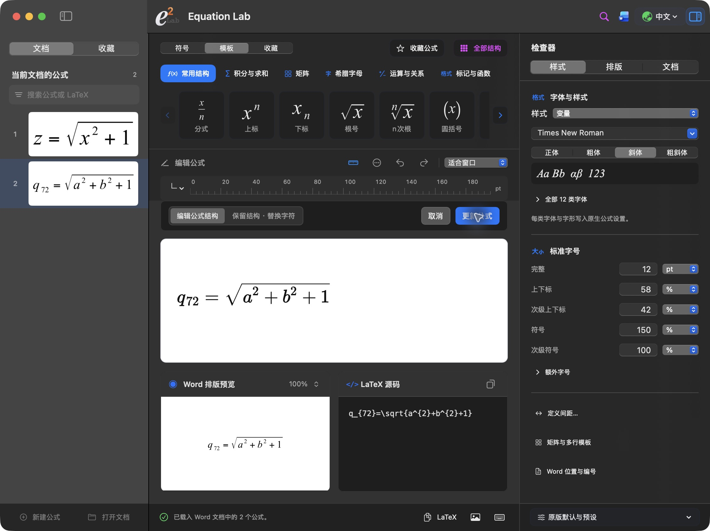

# 实际截图

编辑模式、取消和更新按钮共用一行，左侧可切换当前文档公式。

0.6.4 workbench: editing modes and Word actions share one row; document equations remain selectable in the sidebar.

[30 公式 Word 演示](../examples/equation-lab-30-formulas.docx) · [PDF](../examples/equation-lab-30-formulas.pdf)

These are actual app screenshots and the Word demo exported from Word. The demo contains thirty editable equations across three sections.
