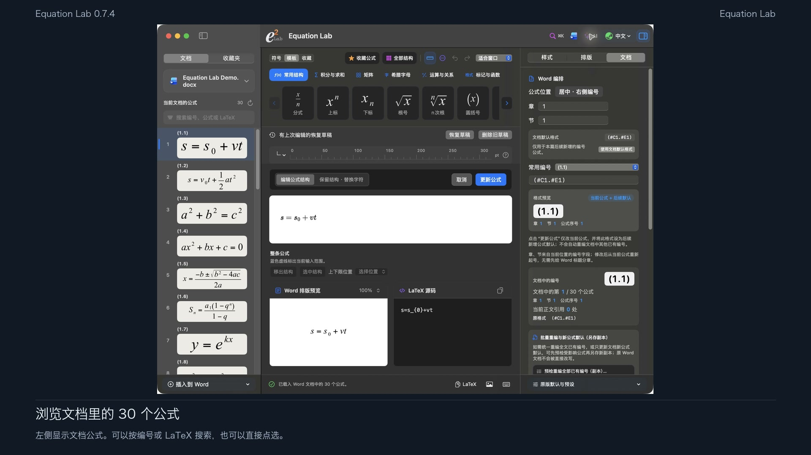
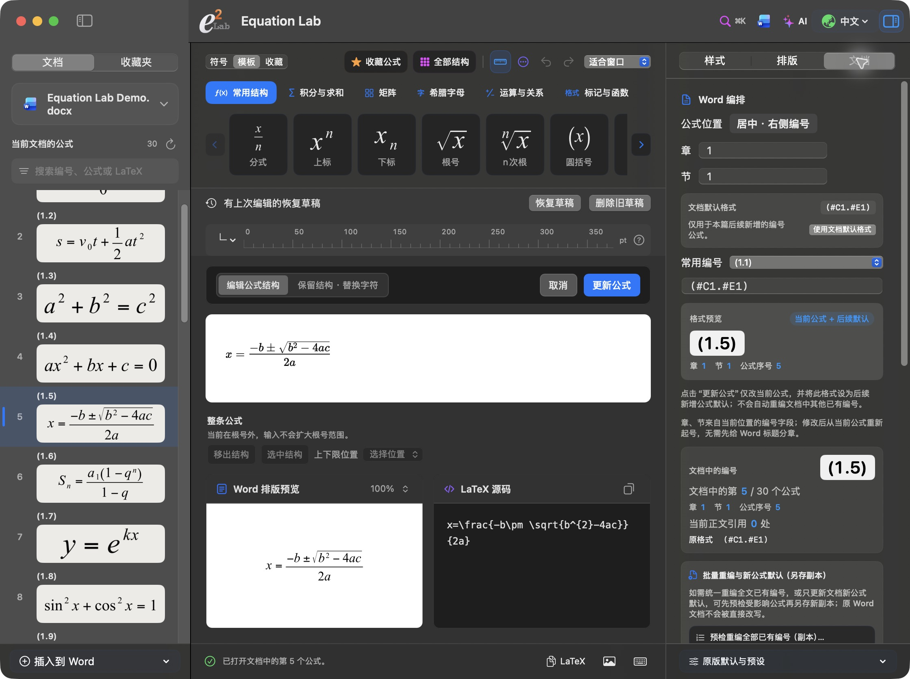
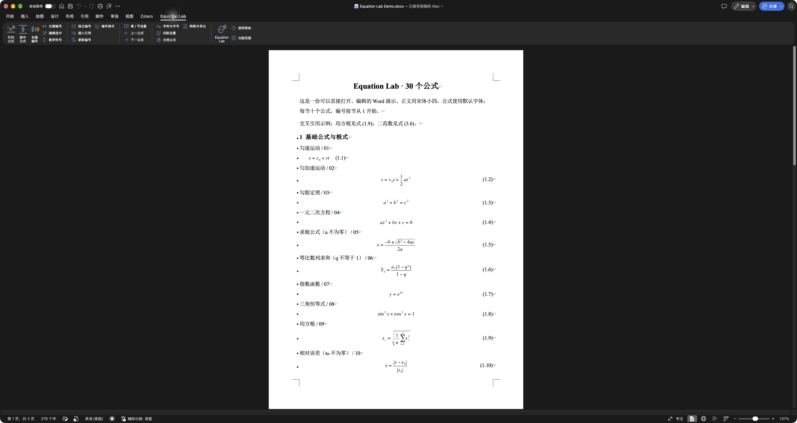
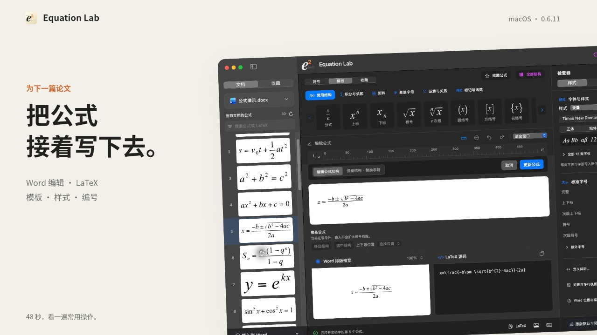
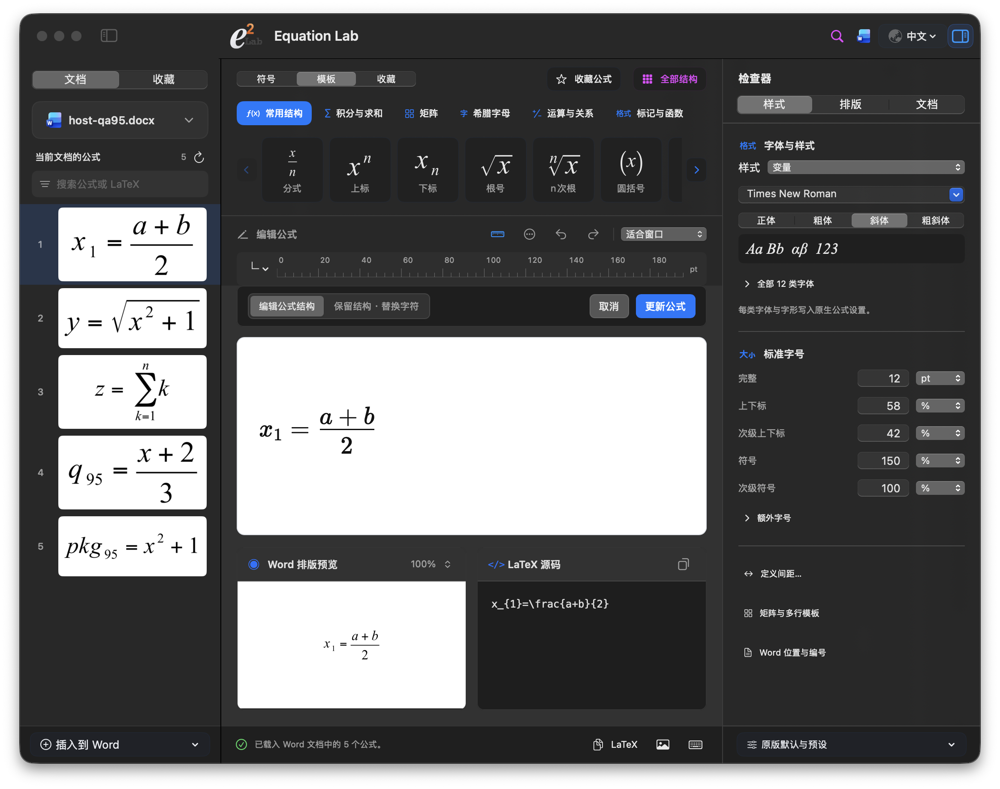
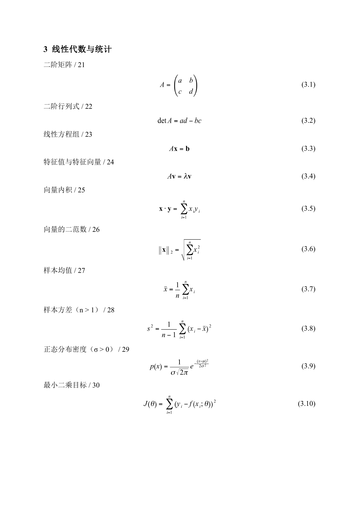
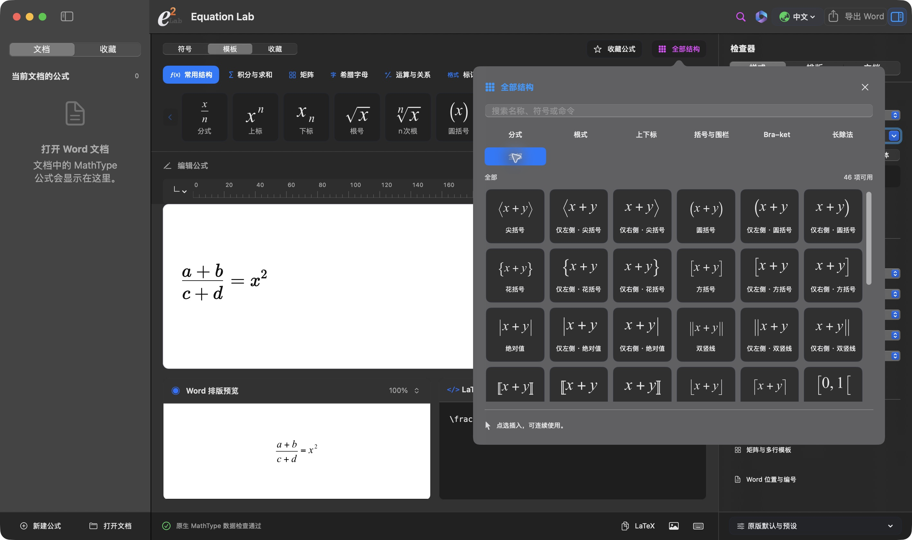
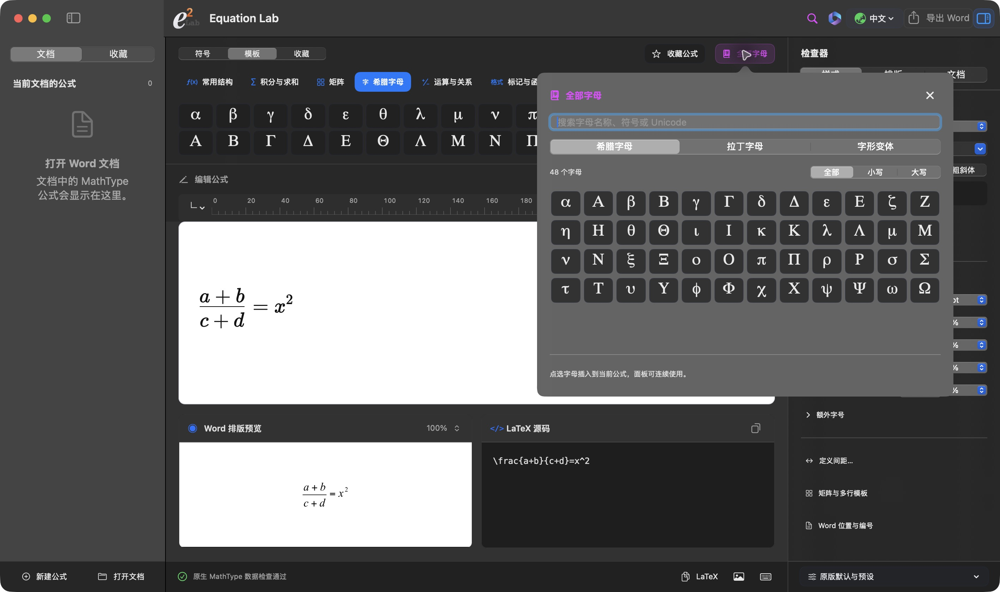
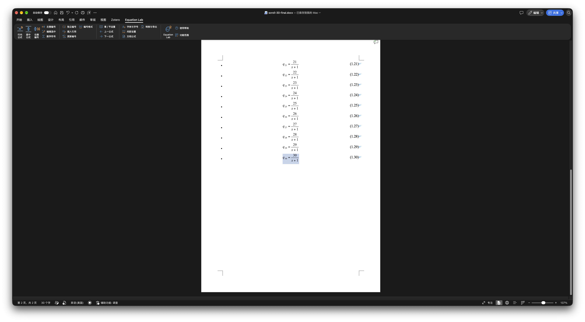

# 演示与实际截图 · Demo and screenshots

## Equation Lab 0.7.4 · build 108

[下载新版演示](https://github.com/Ne1ther/EquationLab/releases/download/v0.7.4/EquationLab-0.7.4-demo-zh.mp4) · 29 秒，1080p，无声，带中文字幕。画面来自 0.7.4 和 Word for Mac 的实际操作，按步骤剪辑。可以看见打开公式、切换条目、预览修改，以及更新回 Word 的结果。

[Download the walkthrough](https://github.com/Ne1ther/EquationLab/releases/download/v0.7.4/EquationLab-0.7.4-demo-zh.mp4) · 29 seconds, 1080p, with Chinese captions. The walkthrough uses step-by-step captures of opening an equation, switching rows, previewing an edit, and saving it back to Word.

[下载演示所用的 30 公式 Word 文档](../examples/equation-lab-30-formulas.docx) · [PDF](../examples/equation-lab-30-formulas.pdf)

旧版截图与视频 · Earlier screenshots and video

[看演示视频](https://github.com/Ne1ther/EquationLab/releases/download/v0.6.11/EquationLab-0.6.11-demo-zh.mp4)：48 秒，1080p / 30 fps，无声中文字幕。画面来自 0.6.11 和 Word for Mac，演示公式编辑、模板输入、字号、编号写回与多文档切换。

[Watch the demo](https://github.com/Ne1ther/EquationLab/releases/download/v0.6.11/EquationLab-0.6.11-demo-zh.mp4): 48 seconds, 1080p at 30 fps, silent with Chinese captions. Real 0.6.11 and Word for Mac screens cover equation editing, templates, font size, numbering, and document switching.

使用 Lieflat Code Video Starter 的时间线与镜头工具制作；字幕使用 Noto Sans SC。画面中的文件均为合成演示文档。

Made with the timeline and camera tools from Lieflat Code Video Starter, using Noto Sans SC for captions. All documents shown are synthetic demo files.

工作台里可以选择文档、浏览公式、编写公式并查看 Word 排版预览。右侧检查器用来调整样式、间距和文档设置。

The workbench combines document selection, equation browsing, editing, and Word layout previews, while the inspector groups typography, spacing, and document settings.

[30 公式 Word 演示](../examples/equation-lab-30-formulas.docx) · [PDF](../examples/equation-lab-30-formulas.pdf)

## 0.6.13 Word 功能区

新版图标和 30 条合成公式的实际 Word 界面。

Refreshed ribbon artwork in Word, shown with 30 synthetic equations.

