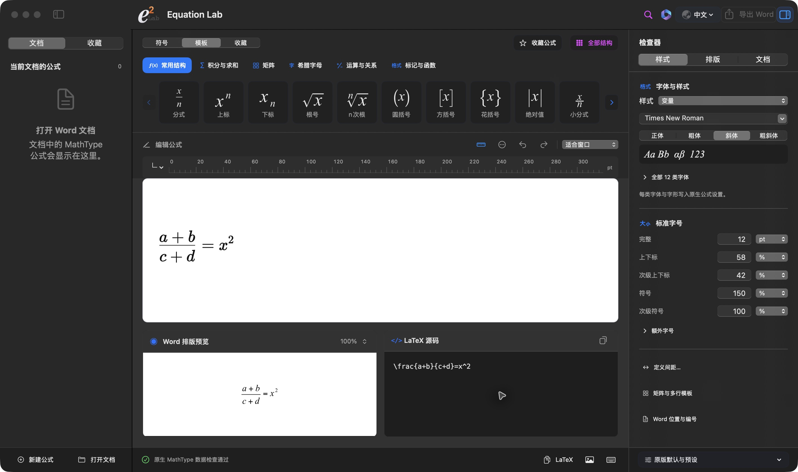
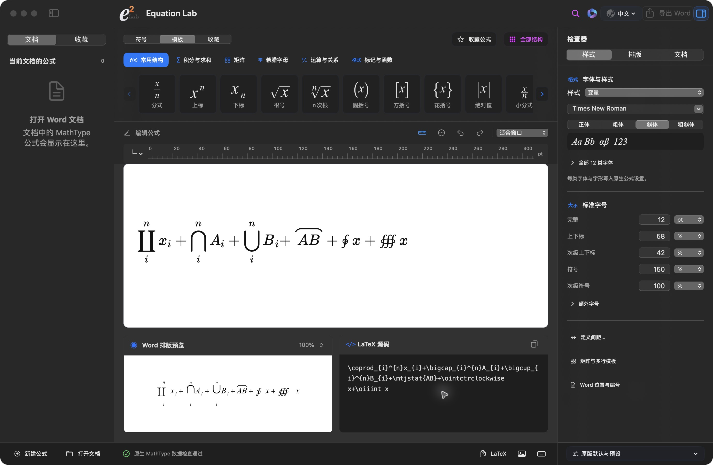

# 工作台预览

2026-10-16，从本机已安装的Equation Lab 0.5.5 build37直接截取。演示公式为 `\frac{a+b}{c+d}=x^2`，展示原生工作台、模板栏、字体设置，以及并排的Word排版预览与LaTeX源码。

截图使用新建公式草稿，未打开个人文档；截图后已恢复空草稿。它展示界面和本例的原生数据检查结果，不作为全部公式或跨平台兼容的验收证据。

本目录只保留当前版本精选截图。以后可增加一段短操作演示；完整操作录像、原版对照图和调试截图仍留在本地研究目录。

## 开放渲染资源的源码预览

2026-10-16，将源码导出到工作区之外，不补入私有文件，安装依赖、编译后实际冷启动。演示包含三个大运算符、联合标记及环积分；原生数据检查通过。这是包含两份替代资源的源码构建；随后生成的 build38 完整 PKG 也包含相同资源。
