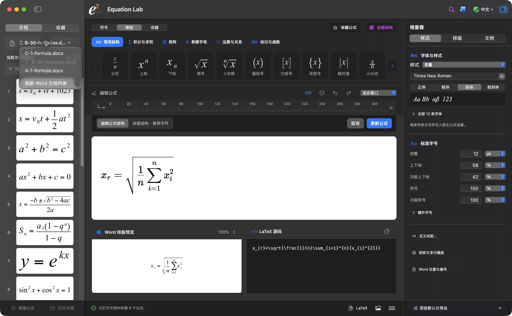

# 演示与实际截图

[看演示视频](https://github.com/Ne1ther/EquationLab/releases/download/v0.6.11/EquationLab-0.6.11-demo-zh.mp4)：48 秒，1080p / 30 fps，无声中文字幕。画面来自 0.6.11 和 Word for Mac，演示公式编辑、模板输入、字号、编号写回与多文档切换。

[Watch the demo](https://github.com/Ne1ther/EquationLab/releases/download/v0.6.11/EquationLab-0.6.11-demo-zh.mp4): 48 seconds, 1080p at 30 fps, silent with Chinese captions. Real 0.6.11 and Word for Mac screens cover equation editing, templates, font size, numbering, and document switching.

使用 Lieflat Code Video Starter 的时间线与镜头工具制作；字幕使用 Noto Sans SC。画面中的文件均为合成演示文档。

Made with the timeline and camera tools from Lieflat Code Video Starter, using Noto Sans SC for captions. All documents shown are synthetic demo files.

文档选择、公式列表、编辑画布与 Word 排版预览。右侧检查器集中调整样式、间距和文档设置。

The workbench brings together document selection, equation browsing, editing, and Word layout previews. The inspector groups typography, spacing, and document tools.

[30 公式 Word 演示](../examples/equation-lab-30-formulas.docx) · [PDF](../examples/equation-lab-30-formulas.pdf)

## 较早版本

