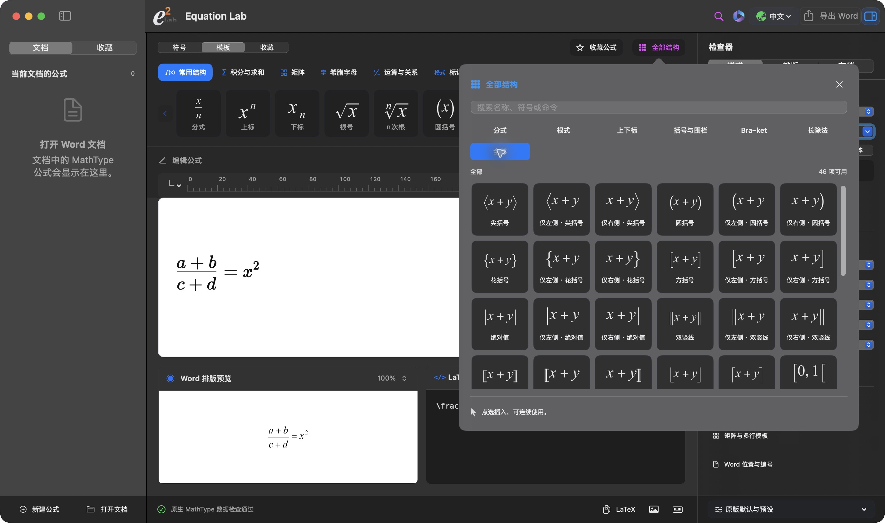
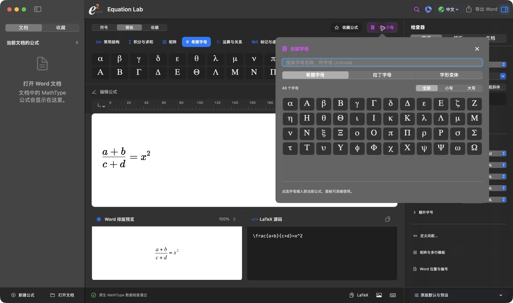
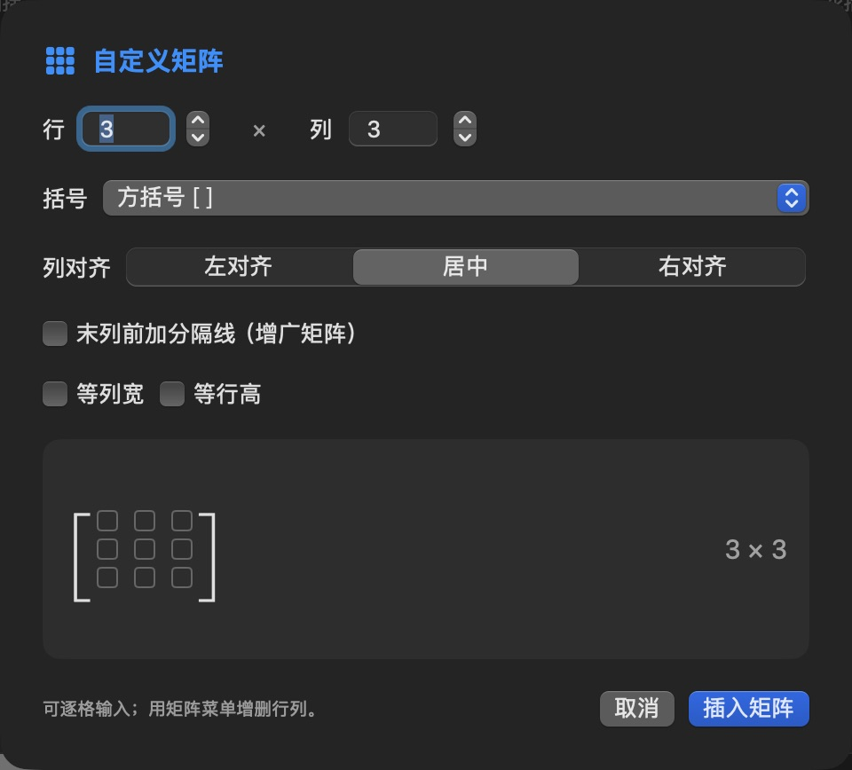
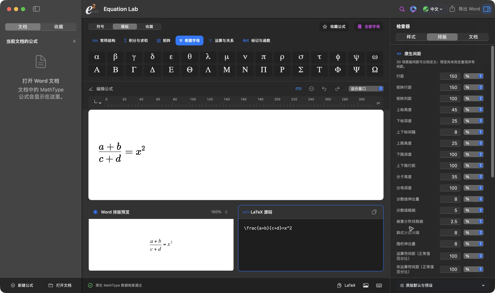
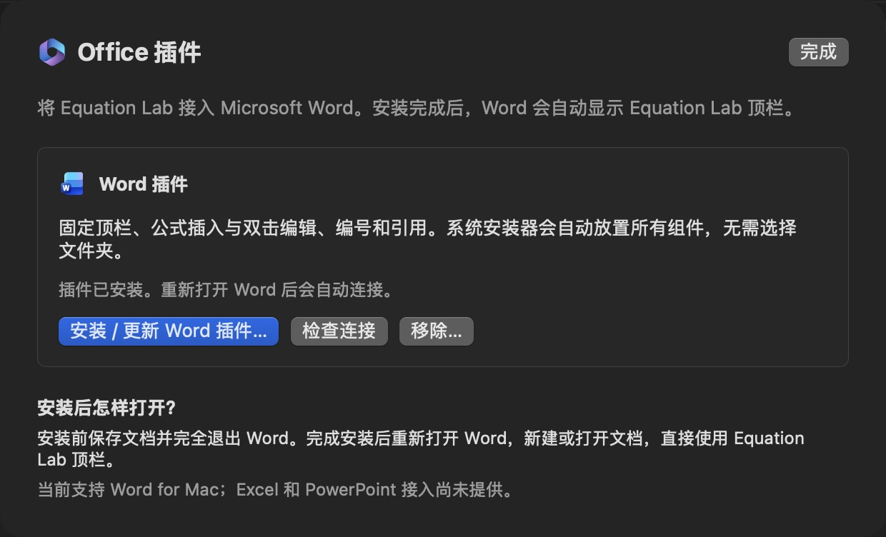

# Equation Lab 界面图库

[返回首页](../../README.md) · [下载 Mac 完整安装包](https://github.com/Ne1ther/EquationLab/releases/download/v0.5.5/Equation-Lab-0.5.5.pkg) · [安装说明](../install.md)

这里是实际运行的界面，不是设计稿。图片可以点开查看原图。前六张于 2026-10-17 直接截自已发布的 **0.5.5 build38**；使用新建的演示草稿，未打开个人文档。最后一张保留了 2026-10-16 的独立源码构建预览。

## 工作台

演示公式为 `\frac{a+b}{c+d}=x^2`。左侧为文档公式区，中间是画布、Word 排版预览和 LaTeX 源码，右侧为字体与字号设置。

## 结构模板库

按分式、根式、上下标和括号等分类，支持搜索和连续插入。截图展示“全部”集合中的括号与围栏部分。

## 字母库

可以按名称、符号或 Unicode 搜索，并筛选大小写。这里展示希腊字母分类。

## 自定义矩阵

设置行列数、括号和对齐方式，也可以添加增广矩阵分隔线、使用等列宽或等行高。截图仅打开设置面板，没有修改文档。

## 排版设置

右侧检查器提供行距、矩阵间距、上下标与分数线等设置。预览尚未完全复现所有原版间距，界面也保留了这项说明。

## Word 插件管理

完整 PKG 默认安装 Word 插件。这里展示 App 内的管理入口；“插件已安装”是截图机器当时的状态，不代表全新机器安装或全部 Word 版本已经完成验证。截图时未执行安装、更新或移除操作。

## 开放渲染资源的源码构建

2026-10-16，将源码导出到工作区之外，不补入私有文件，安装依赖、编译后实际冷启动。演示包含三个大运算符、联合标记及环积分；原生数据检查通过。这是包含两份替代资源的源码构建；随后生成的 build38 完整 PKG 也包含相同资源。

## 图标

[1024 像素 PNG](../../design/equation-lab-icons/v6/png/e2-lab-cream-optical-1024.png) · [矢量 SVG](../../design/equation-lab-icons/v6/svg/e2-lab-cream-optical.svg) · [macOS ICNS](../../design/equation-lab-icons/v6/EquationLab.icns)

截图用于展示界面和这些示例的实际状态，不作为全部公式或跨平台兼容性的验收证据。截图后已恢复空白草稿。完整研究对照与调试截图保留在本地。
